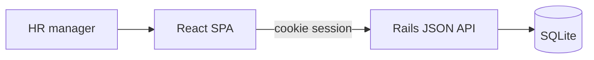
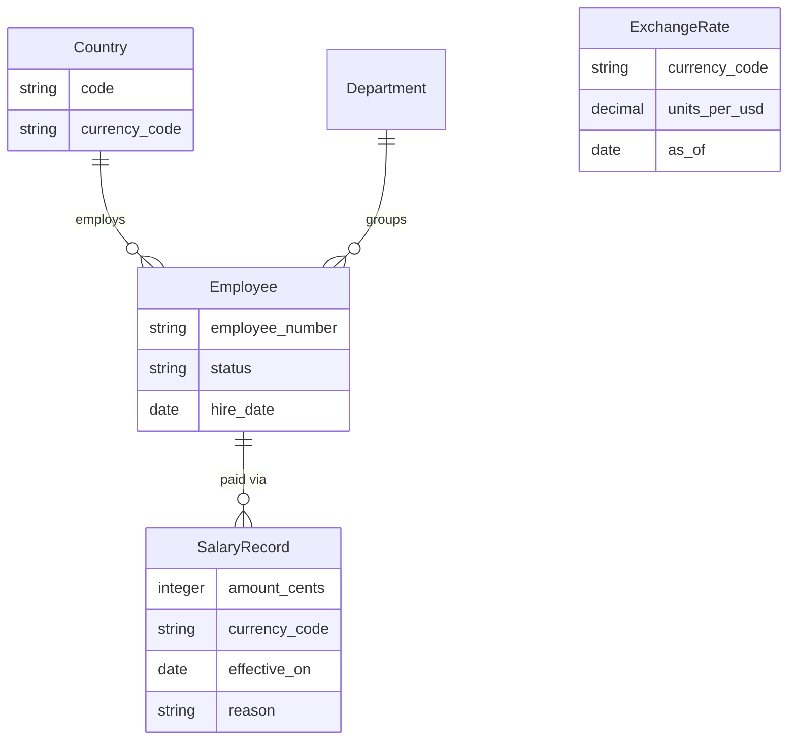

# Architecture

Acme Compensation is a Rails 7.2 application on Ruby 3.2.2 with a React interface. SQLite holds the data. One process serves the built UI and the JSON API in production. In development, Vite proxies `/api` to Rails so the browser still sees a single origin.

## Domain

`SalaryRecord` is the source of truth. Employee does not cache a current amount, so the directory and the dashboard cannot drift apart. At 10,000 people the current-salary query is a grouped max effective date, backed by a unique index on `(employee_id, effective_on)`.

Money is a value object. It parses a major-unit string with `BigDecimal`, stores minor units, and refuses extra decimal places. Yen has exponent 0. There is no `money` gem and no float on the write path.

## Request path

| Piece | Responsibility |
| --- | --- |
| `Employees::Hire` | Creates the person and the opening salary in one transaction |
| `Salaries::RecordChange` | Appends a change. Promotions may also update level and title |
| `Employees::UpdateProfile` | Edits HR-owned fields. Refuses a country change |
| `Employees::Directory` | Search, filters, pagination. Salary sort requires a country |
| `Compensation::Snapshot` | Aggregates current pay for people on payroll |
| `Compensation::CsvExport` | Same population as the snapshot, as a spreadsheet |
| `Api::V1` | Session cookie, CSRF token, JSON for the SPA |

On leave is on payroll. Terminated is not. A future effective date is not current.

## Interface

The SPA lives in `frontend/` (Vite, React, Mantine). Rails serves `public/index.html` for browser routes and `public/vite` for built assets, so a reviewer can run the app with Ruby alone. The API is under `/api/v1` and requires an HR session except for the session endpoints.

Reference data (countries, departments, levels, reasons) is loaded once for the forms. The client does not reimplement payroll math. It displays amounts the API already formatted, plus the minor units those amounts came from.

## What we kept from the Rails app

The generated app already had SQLite, Minitest, RuboCop, Brakeman, and a Dockerfile. Those stayed. Hotwire is unused. The brief asks for React, and a second UI stack would split the product. The JSON API is the boundary the tests hold.
